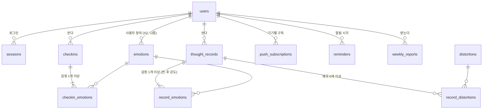

# 데이터 모델

> **무엇을 어디에 저장하고, 왜 그렇게 생겼는지** 적는 문서다. PostgreSQL 테이블과 Valkey 키를 둘 다 다룬다.
> **컬럼 하나하나의 원본은 마이그레이션 파일**(`internal/db/migrations/*.sql`)이다. 이 문서는 관계 · 규칙 · 이유만 적고, 컬럼 표를 옮겨 적지 않는다.
> 저장소 역할 분담 원칙은 [decisions/0005](decisions/0005-valkey.md), 요구사항 번호(T3 등)는 [REQUIREMENTS.md](REQUIREMENTS.md).

## 1. 공통 규칙
| 규칙 | 내용 | 이유 |
|---|---|---|
| 기본 키 | 사용자 데이터는 `uuid` + 기본값 `uuidv7()` (PostgreSQL 18 내장) | 순번 id는 주소에서 전체 개수 · 남의 id를 짐작하게 한다. v7은 시간순이라 인덱스가 v4보다 덜 흩어진다 |
| 마스터 데이터 키 | `smallint` identity (감정 · 인지 왜곡) | 몇십 개뿐이고 밖에 노출돼도 문제없다 |
| 시각 | 전부 `timestamptz`, UTC로 저장 | "하루"의 경계는 사용자 시간대(`users.timezone`)로 계산한다 |
| 소유자 | 사용자 데이터는 `users`에서 `ON DELETE CASCADE`로 이어진다 | 탈퇴 = `users` 한 행 삭제로 끝 (REQUIREMENTS 5.1절) |
| 이름 | 테이블 복수형 `snake_case`, 연결 테이블은 `부모_자식` | |
| 강도 | `smallint` + `CHECK (0 ~ 100)` | 앱 검증과 별개로 DB가 마지막 방어선 |
| 감사 컬럼 | `created_at`, 수정되는 테이블은 `updated_at` | |

## 2. 관계도

## 3. 테이블별 설계 메모

### 3.1 `users`
- 이메일은 앱에서 소문자로 정규화해 저장하고 `UNIQUE` + `CHECK (email = lower(email))`. (`citext` 확장을 쓰지 않으려고)
- `timezone`: IANA 이름, 기본 `Asia/Seoul` (A4).
- 비밀번호는 argon2id 해시 문자열(파라미터 포함 PHC 형식)만 저장한다.

### 3.2 `sessions`
- 토큰 원문은 쿠키에만 있다. DB에는 **SHA-256 해시**(`token_hash`, `UNIQUE`)만 (ARCHITECTURE 4절).
- `remember`(로그인 유지 여부, REQUIREMENTS A1)에 따라 기한이 다르다.
  | | 쿠키 | 서버 기한 |
  |---|---|---|
  | 로그인 유지 | `Max-Age` 30일 | 마지막 사용 후 **30일** |
  | 유지 안 함 | 세션 쿠키(브라우저를 닫으면 사라짐) | 마지막 사용 후 **12시간** — 브라우저를 안 닫고 자리를 떠도 반나절이면 끝난다 |
- 요청마다 쓰지 않도록, `last_seen_at`이 일정 시간(유지 1일 / 비유지 10분) 넘게 지났을 때만 `last_seen_at` · `expires_at`을 갱신한다. 갱신은 Valkey 캐시를 놓쳐 Postgres를 읽을 때 한다.
- 비밀번호 변경 · 다른 기기 모두 로그아웃(A8) → 지금 세션을 뺀 그 사용자의 세션 전부 삭제. 탈퇴 → CASCADE. **어느 경우든 지운 `token_hash`로 Valkey `sess:` 키도 지운다**(ARCHITECTURE 4절, 4.5절).
- 만료된 행은 worker가 하루 한 번 지운다.

### 3.3 마스터: `emotions` · `distortions`
- `emotions.user_id`가 `NULL`이면 시스템 기본 감정, 값이 있으면 사용자 정의(X2, 지금은 안 씀). `UNIQUE NULLS NOT DISTINCT (user_id, name)`로 기본 감정끼리도 이름이 안 겹치게.
- `distortions`는 시스템 전용. `description` · `example`은 `NULL` 허용 — **문구는 사용자가 직접 쓴다**(2026-10-29 결정). 비어 있으면 화면은 이름만 보여 준다.
- 둘 다 `sort_order`로 화면 순서를 정한다. 기록이 참조 중인 마스터 행은 지우지 못한다(`ON DELETE RESTRICT`). 안 쓰게 된 항목은 `archived_at`으로 숨긴다.

**seed (마이그레이션에 포함)**
| 종류 | 항목 |
|---|---|
| 감정 10개 | 불안 · 두려움 · 슬픔 · 무기력 · 분노 · 짜증 · 수치심 · 죄책감 · 외로움 · 좌절 |
| 인지 왜곡 11개 | 흑백논리 · 과도한 일반화 · 정신적 필터 · 긍정적인 것 무시하기 · 성급한 결론(독심술/예언자적 오류) · 확대와 축소 · 감정적 추론 · 당위적 진술 · 낙인찍기 · 개인화 · 파국화 (v1과 같음) |

### 3.4 `checkins` · `checkin_emotions`
- `checkins`: `occurred_at`(기본 지금), `note`(선택, 한 줄).
- `checkin_emotions`: 기본 키 `(checkin_id, emotion_id)` — 한 체크인에 같은 감정 중복 불가. 강도 1개.
- "감정 1개 이상"은 앱(service)에서 검사한다. DB만으로는 "자식이 최소 1행"을 강제하기 어렵다.

### 3.5 `thought_records` · `record_emotions` · `record_distortions`
- `thought_records`에는 **완료된 기록만** 들어간다. 작성 중 초안은 Valkey에 있다(4.3절). 그래서 상태(`draft`/`done`) 컬럼이 없다.
- 칸: `occurred_at`(T6) · `situation` · `automatic_thought` · `evidence_for` · `evidence_against` · `alternative_thought`.
  - 필수: 상황 · 자동 사고 · 대안 사고. 근거 · 반대 근거는 빈 문자열 허용(못 찾는 날도 있다). `NULL` 대신 `''`로 통일한다.
  - 글자 수 제한은 앱 검증(OpenAPI 스펙에 `maxLength`)으로.
- `record_emotions`: 기본 키 `(record_id, emotion_id)`, **`intensity_before` · `intensity_after` 둘 다 NOT NULL** — 고른 감정마다 전 · 후를 전부 매긴다(2026-10-29 결정). D2(평균 변화, 점)는 감정별 `intensity_after − intensity_before`의 평균이다. 비율로 나누지 않으므로 전 강도가 0이어도 계산된다.
- `record_distortions`: 기본 키 `(record_id, distortion_id)`. 0개도 허용(왜곡을 못 찾는 날도 기록은 남긴다).
- 수정(T5)은 한 트랜잭션에서 본문 `UPDATE` + 자식 테이블 지우고 다시 넣기.

### 3.6 `push_subscriptions` · `reminders`
- `push_subscriptions`: 브라우저 · 기기마다 1행. `endpoint` `UNIQUE`, 키 `p256dh` · `auth`. 푸시 서버가 404/410을 주면 지운다.
- `reminders`: `local_time`(`time`, 사용자 시간대 기준), `weekdays`(요일 비트마스크 0~127, 기본 127 = 매일), `enabled`.
- 같은 리마인더가 하루 두 번 나가지 않게 하는 건 asynq 작업 id(`reminder:{id}:{현지 날짜}`)로 막는다. DB에 발송 기록 테이블을 두지 않는다.

### 3.7 `weekly_reports`
- `week_start`(사용자 현지 기준 월요일, `date`) + `summary`(`jsonb`).
- `UNIQUE (user_id, week_start)` — 작업이 두 번 돌아도 한 주에 한 행(멱등, ARCHITECTURE 5절).
- `summary`를 `jsonb`로 둔 이유: 리포트 항목이 바뀌어도 마이그레이션이 필요 없고, 한 번 만들면 다시 계산하지 않는 스냅숏이라서.

### 3.8 인덱스
| 인덱스 | 쓰는 곳 |
|---|---|
| `sessions (token_hash)` UNIQUE | 매 요청 세션 조회 |
| `sessions (user_id)` | 비밀번호 변경 시 세션 정리 |
| `checkins (user_id, occurred_at DESC)` | 목록 · 오늘 체크인 · 통계 기간 조회 |
| `thought_records (user_id, occurred_at DESC)` | 같음 |
| `push_subscriptions (user_id)` · `reminders (user_id)` | 사용자별 조회 |
| `reminders (local_time) WHERE enabled` | worker가 "지금 보낼 것" 찾기 |

### 3.9 삭제 정책
| 관계 | 정책 | 이유 |
|---|---|---|
| `users` → 모든 사용자 데이터 | CASCADE | 탈퇴 즉시 완전 삭제 |
| `checkins` / `thought_records` → 자식 테이블 | CASCADE | 기록을 지우면 감정 · 왜곡 연결도 같이 |
| `emotions` / `distortions` ← 자식 테이블 | RESTRICT | 참조 중인 마스터는 못 지움 → `archived_at`으로 숨긴다 |

## 4. Valkey 키

### 4.1 공통 규칙
- 키 이름은 `종류:식별자[:세부]`. 사용자 이메일 같은 **개인정보를 키 이름에 넣지 않는다**(필요하면 해시).
- **TTL 없는 키를 만들지 않는다.** 예외는 `asynq:*`(라이브러리가 관리, 직접 건드리지 않음).
- 설정은 AOF(`appendonly yes`)로 켜 둔다 → 재시작해도 초안이 남는다. 볼륨까지 지우면 초안만 사라진다.

### 4.2 키 목록
| 키 | 자료형 | TTL | 내용 | 날아가면 |
|---|---|---|---|---|
| `sess:{token_hash}` | string | 10분 | 세션의 `user_id` · 만료 시각 | Postgres에서 다시 읽음 (느려질 뿐) |
| `rl:login:ip:{ip}` | string(카운터) | 15분 | 로그인 시도 횟수 | 제한이 초기화됨 |
| `rl:login:acct:{email_hash}` | string(카운터) | 15분 | 계정별 로그인 실패 횟수 | 같음 |
| `rl:signup:ip:{ip}` | string(카운터) | 1시간 | 가입 시도 횟수 | 같음 |
| `draft:{user_id}:{draft_id}` | string(JSON) | 14일 | 작성 중 사고 기록 전체 + `rev` | **초안 손실** (유일하게 잃는 것) |
| `drafts:{user_id}` | sorted set | 14일 | 그 사용자의 초안 id (점수 = 마지막 저장 시각) | 초안 목록을 못 찾음 |
| `stats:ver:{user_id}` | string(숫자) | 30일 | 통계 캐시 버전 | 캐시 미스 (다시 계산) |
| `stats:{user_id}:{ver}:{현지 날짜}:{종류}:{기간}` | string(JSON) | 1시간 | 대시보드 집계 결과. 현지 날짜(사용자 시간대의 오늘)를 키에 넣어 자정이 지나면 새로 계산된다 | 다시 계산 |

### 4.3 초안 자동저장 (T3)
- 화면이 몇 초마다(입력이 멈추면) 초안 전체를 보낸다 → `draft:` 덮어쓰기 + `drafts:` 점수 갱신 + TTL 연장.
- **동시 편집 충돌**: 초안마다 `rev`(정수)를 둔다. 클라이언트는 받은 `rev`를 같이 보내고, 서버의 `rev`와 다르면 409 → "다른 기기에서 수정됨" 안내. 같으면 저장하고 `rev + 1`.
- 사용자당 초안 최대 10개. 넘으면 새 초안을 거절한다(오래된 걸 몰래 지우지 않는다).
- **만료된 초안 정리**: 초안 키는 각자 14일 TTL로 사라지지만 `drafts:` 목록에는 id가 남는다. 목록을 읽을 때(목록 조회 · 10개 검사) 키가 없는 id는 `ZREM`으로 지운 뒤 센다 — 유령 초안이 개수를 차지하지 않게.
- 완료 → Postgres 트랜잭션 커밋이 **성공한 뒤에** 초안 키를 지운다(실패하면 초안이 남아 다시 시도 가능).
- 완료한 기록을 수정할 때는 초안을 쓰지 않는다(수정 화면에서 바로 저장).

### 4.4 통계 캐시 무효화
- 키를 찾아 지우는 대신 **버전을 올린다**: 체크인 · 사고 기록을 저장 · 수정 · 삭제하면 `INCR stats:ver:{user_id}`. 옛 버전 키는 아무도 안 읽다가 TTL로 사라진다.
- 이유: 사용자별 키를 `SCAN`으로 찾아 지우는 건 느리고 빠뜨리기 쉽다.

### 4.5 탈퇴 시 Valkey 정리
Postgres CASCADE와 별도로 지운다: 그 사용자의 `sess:*`(삭제 전에 `sessions`에서 `token_hash`를 `RETURNING`으로 받아서), `drafts:{user_id}`와 그 안의 `draft:*`, `stats:ver:{user_id}`. 요청 제한 · 통계 키는 TTL로 곧 사라진다.

---

## 변경 이력
| 날짜 | 내용 |
|---|---|
| 2026-10-29 | v2 첫 작성. 감정 10개 seed, 왜곡 설명은 사용자가 직접 작성, 후 강도는 감정마다 전부 (사용자 결정) |
| 2026-10-29 | 문서 검토 반영: 3.2 로그인 유지 여부별 기한(30일 / 12시간), 세션 삭제 시 Valkey 캐시 삭제(빠져 있으면 비밀번호를 바꿔도 옛 세션이 최대 10분 살아 있었음), 3.5 D2를 평균 변화(점)로, 4.2 통계 키에 현지 날짜, 4.3 만료된 초안 id 정리 |
