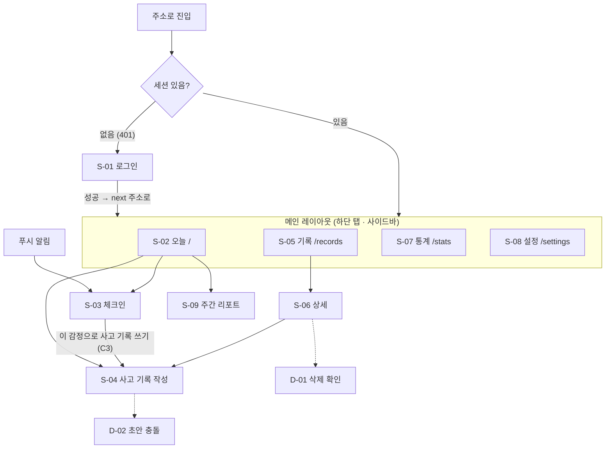

# 화면 설계

> **화면이 어떻게 생겼고, 왜 그렇게 동작하는지** 적는 문서다. 화면 규격 · 색 결정의 단일 출처다.
> 기능 번호(C1 · T3 등)는 [REQUIREMENTS.md](REQUIREMENTS.md), 저장 방식은 [DATA_MODEL.md](DATA_MODEL.md), 인증 흐름은 [ARCHITECTURE.md](ARCHITECTURE.md) 4절.
> 그림(목업)은 [`mockups/`](mockups/) — 이 문서의 결정을 보여 주는 참고 자료다.

## 1. 이 앱의 화면 원칙
일반 앱 원칙(접근성, 로딩 처리 등)은 7 ~ 8장에. 여기는 **감정 기록 앱이라서** 지키는 것만.

1. **붙잡기는 휴대폰, 정리는 어디서든** (REQUIREMENTS 5.4절).
   - 붙잡기(체크인, 사고 기록 1 ~ 3단계)는 휴대폰 화면을 먼저 설계한다. 체크인은 앱을 열고 10초 안에 끝나야 한다(C1). 자주 누르는 버튼은 엄지가 닿는 화면 아래쪽에, 터치 영역은 44px 이상.
   - 정리(사고 기록 4 ~ 8단계, 통계)는 PC와 휴대폰 둘 다 제대로 쓰이게 한다. PC에서는 넓은 화면을 "앞에서 쓴 답을 보면서 쓰기"에 쓴다(4.3절).
   - 흐름은 기기마다 따로 만들지 않는다. 같은 단계 흐름에 배치만 바뀐다.
2. **감정을 평가하지 않는다.**
   - 감정에 "좋은 색 / 나쁜 색"을 붙이지 않는다. 빨강 · 초록으로 강도나 변화를 표시하지 않는다(6장).
   - 강도가 안 줄었거나 늘어도 실패처럼 보이게 하지 않는다. "−45" 같은 숫자는 보여 주되 빨간 화살표 · 경고 아이콘은 없다.
   - 점수 · 등급 · 연속 기록 압박("기록이 끊겼어요!") 문구를 쓰지 않는다.
3. **화면 밖으로 내용이 새지 않게 한다.** 푸시 알림 · 탭 제목 · 공유 미리보기에 기록 내용(상황 · 생각 · 메모)을 넣지 않는다.
4. **쓰던 걸 잃지 않게 한다.** 사고 기록은 길다. 자동 임시저장(T3)이 지금 저장됐는지 늘 보이고, 저장이 실패하면 숨기지 않고 알린다.

## 2. 화면 목록

| ID | 화면 | 주소 | 우선 | 설명 |
|---|---|---|:---:|---|
| S-01 | 로그인 | `/login` | M | 가입은 `ALLOW_SIGNUP`이 켜졌을 때만 전환 링크 표시 |
| S-02 | 오늘 (홈) | `/` | M | 체크인 버튼, 오늘 기록, 이어 쓸 초안 |
| S-03 | 체크인 작성 · 수정 | `/checkin` · `/checkin/:id/edit` | M | 감정 · 강도 · 메모 · 시각. 푸시 알림을 누르면 바로 여기 |
| S-04 | 사고 기록 작성 · 수정 | `/records/new?draft=…&step=…` · `/records/:id/edit` | M | 한 화면 한 칸 단계형 (T2) |
| S-05 | 기록 목록 | `/records` | M | 체크인 + 사고 기록, 날짜별 |
| S-06 | 사고 기록 상세 | `/records/:id` | M | 7칸 전체, 전 · 후 강도 |
| S-07 | 통계 | `/stats?range=…` | M | 추이 · 전후 변화 · 왜곡 비율 |
| S-08 | 설정 | `/settings` | M | 계정 · 시간대 · 테마 · 리마인더 · 내보내기 · 탈퇴 |
| S-09 | 주간 리포트 | `/reports/:week_start` | S | 한 주 요약 |
| D-01 | 삭제 확인 | 다이얼로그 | M | 기록 · 체크인 삭제 |
| D-02 | 초안 충돌 | 다이얼로그 | M | 다른 기기에서 먼저 저장됨 (DATA_MODEL 4.3절의 409) |

**페이지 / 다이얼로그 기준**: 주소로 다시 들어올 만하거나 입력이 많으면 페이지, 지금 화면 위에서 끝나는 확인 · 선택이면 다이얼로그. 체크인(S-03)은 짧지만 **푸시 알림에서 주소로 바로 들어와야 해서** 페이지다.

## 3. 이동 구조

### 3.1 화면 흐름

실선은 페이지 이동, 점선은 다이얼로그.

- **로그인 뒤 가려던 주소로 돌아간다.** `?next=`는 앱 내부 경로(`/`로 시작하고 `//` · `/\`로 시작하지 않는 것)만 받는다 — 바깥 주소로 튕기는 오픈 리다이렉트 방지. 브라우저는 `/\evil.com`도 `//evil.com`처럼 읽는다.
- **화면 상태는 주소에.** 목록 필터 · 통계 기간 · 작성 중 단계(`step`)를 쿼리에 둔다. 새로고침 · 뒤로가기에도 보던 화면이 유지된다.
- 앱을 열면 세션 확인이 끝날 때까지 짧은 로딩을 보여 준다(로그인 화면이 번쩍 보였다 사라지지 않게).

### 3.2 레이아웃
```
[모바일 · 48rem 미만]                [데스크톱 · 48rem 이상]
┌──────────────────────┐            ┌────────────┬──────────────────────────┐
│ 화면 제목     [동작]  │            │ 로고        │ 화면 제목          [동작] │
├──────────────────────┤            │ ▸ 오늘      ├──────────────────────────┤
│                      │            │   기록      │                          │
│       본문            │            │   통계      │   본문 (최대 폭 40rem,    │
│                      │            │   설정      │   가운데 정렬)            │
├──────────────────────┤            │             │                          │
│ 오늘  기록  통계  설정 │            │ [+ 체크인]  │                          │
└──────────────────────┘            └────────────┴──────────────────────────┘
```
- 기준은 `48rem`(Tailwind `md:`). px이 아니라 rem이라 브라우저 글꼴을 키운 사람은 더 일찍 모바일 배치를 받는다 — 글자가 크면 한 줄에 들어가는 정보가 적으니 의도에 맞다.
- 모바일 하단 탭은 4개. 체크인은 탭이 아니라 S-02의 큰 버튼 + 데스크톱 사이드바 버튼(가장 자주 하는 동작을 메뉴 사이에 묻지 않는다).
- **사고 기록 작성(S-04) 중에는 하단 탭을 숨긴다.** 실수로 다른 탭을 눌러 흐름이 끊기지 않게, 키보드가 올라왔을 때 화면을 더 쓰게.
- 데스크톱도 본문은 좁게(최대 40rem). 글을 쓰는 앱이라 한 줄이 너무 길면 읽기 · 쓰기가 불편하다. 예외는 S-04의 정리 단계 — 본문 옆에 "앞에서 쓴 답" 패널을 둔다(4.3절).

## 4. 화면별 상세
와이어프레임은 **무엇이 어떤 순서로** 들어가는지만 보여 준다. 모바일 폭 기준.

### 4.1 S-02 오늘 (홈)
```
┌──────────────────────────┐
│     2026년 10월 29일 수요일   │  ← 명조 (6장 D2)
│   오늘은 어떤 하루였나요?    │
│                          │
│          ╭────╮          │
│        (  체크인  )        │  ← 가운데 큰 원 → S-03 (6장 "체크인 원")
│          ╰────╯          │
│    숨 한 번 고르고 눌러요     │
│     [ 사고 기록 쓰기 ]       │  ← 보조 버튼 → S-04
├──────────────────────────┤
│ 이어 쓰기                  │  ← 초안이 있을 때만
│ 3/8  회의 끝나고… · 2시간 전 │
├──────────────────────────┤
│ 오늘                      │
│ 09:12  불안 60 ●●●○○      │  ← 왼쪽 여백에 시각(일기 형식), 강도는 숫자 + 점 5개
│        무기력 40 ●●○○○     │
│ 13:40  짜증 70 ●●●●○      │
│ 18:05  사고 기록 · 불안 80→35 │
└──────────────────────────┘
```
| 항목 | 규격 |
|---|---|
| 이어 쓰기 | 초안 목록(최근 저장순). 상황 칸 앞부분 + 단계 + 저장 시각. 길게 누르거나 `⋮`로 초안 삭제 |
| 오늘 목록 | "오늘" = 사용자 시간대 기준 하루. 체크인 · 사고 기록을 시간순 |
| 주간 리포트 | 새 리포트가 있으면 맨 위에 한 줄 카드 → S-09 (S) |

### 4.2 S-03 체크인
```
┌──────────────────────────┐
│ ×  체크인          [저장] │
├──────────────────────────┤
│ 지금 어떤 감정인가요?       │
│ [불안✓][두려움][슬픔]       │  ← 칩, 여러 개
│ [무기력][분노][짜증✓]       │
│ [수치심][죄책감][외로움][좌절]│
├──────────────────────────┤
│ 불안         ━━━━━●── 60  │  ← 고른 감정마다 강도
│ 짜증         ━━●───── 30  │
├──────────────────────────┤
│ 메모 (선택)                │
│ ┌──────────────────────┐ │
│ └──────────────────────┘ │
│ 시각  지금 ▾               │
└──────────────────────────┘
```
| 항목 | 규격 |
|---|---|
| 강도 입력 | 슬라이더 0 ~ 100, 5 단위. 칩을 고르면 슬라이더가 **50**에서 시작(0에서 시작하면 매번 끌어야 한다). 숫자는 슬라이더 옆에 항상 표시 |
| 저장 버튼 | 감정 1개 이상이면 활성. 모바일은 화면 아래 고정 버튼으로도 |
| 저장 후 | S-02로 돌아가고 토스트 "기록했어요"(M). **(S, C3)** 토스트에 [사고 기록 쓰기] 버튼(5초)을 붙이고, 강도 70 이상이면 토스트 대신 S-02 맨 위 안내 카드로 조금 더 오래 보여 준다 |
| 수정 모드 | `/checkin/:id/edit` — 같은 화면에 기존 값을 채워 연다(C4). 헤더에 삭제(D-01) |
| 메모 | 한 줄(최대 200자). 상세한 건 사고 기록으로 |

> 강도 70 기준은 처음 정한 값이다. 써 보고 조정한다.

### 4.3 S-04 사고 기록 작성 (단계형)
```
┌──────────────────────────┐
│ ←  사고 기록    저장됨 · 방금 │  ← 저장 상태 늘 표시
│ ■■■□□□□□  3 / 8           │
├──────────────────────────┤
│ 그때 머릿속에 스친 생각은?    │  ← 단계 제목 (질문형)
│ 떠오른 그대로 써도 돼요.     │  ← 도움말 한 줄
│ ┌──────────────────────┐ │
│ │                      │ │
│ │                      │ │
│ └──────────────────────┘ │
├──────────────────────────┤
│ [ 이전 ]        [ 다음 ]  │  ← 화면 아래 고정
└──────────────────────────┘
```
| 단계 | 내용 | 필수 |
|---|---|:---:|
| 1 | 상황 + 일어난 시각(T6) | ✓ |
| 2 | 감정 고르기 + 각각 강도(전) — S-03과 같은 부품 | ✓ (1개 이상) |
| 3 | 자동 사고 | ✓ |
| 4 | 인지 왜곡 고르기(복수). 항목을 펼치면 설명 · 예시(T4, 사용자가 쓴 문구. 비어 있으면 이름만) | |
| 5 | 근거 — 자동 사고가 맞다고 볼 수 있는 사실 | |
| 6 | 반대 근거 — 자동 사고와 맞지 않는 사실 | |
| 7 | 대안 사고 — 5 · 6을 보고 균형 잡힌 생각. **3번 자동 사고를 위에 접어서 보여 준다** | ✓ |
| 8 | 감정 다시 매기기(후) — 2단계 감정마다, 전 강도를 흐리게 같이 표시 | ✓ |
| 완료 | 요약 카드(감정 전 → 후) → [완료] → S-06 | |

1 ~ 3단계가 **붙잡기**, 4 ~ 8단계가 **정리**다. 3단계를 마치면 [다음] 옆에 **[나중에 이어 쓰기]** 를 보여 준다 → 초안으로 남기고 S-02로. 감정이 올라온 순간에 반대 근거까지 찾으라고 하지 않는다.

**데스크톱 배치 (48rem 이상, 4 ~ 8단계)**
```
┌────────────┬──────────────────────────────┬───────────────────────┐
│ (사이드바) │ ←  사고 기록      저장됨 · 방금 │ 앞에서 쓴 답           │
│            │ ■■■■■□□□  5 / 8               │ 상황                  │
│            │ 이 생각이 맞다고 볼 수 있는     │  회의에서 발표 중에…   │
│            │ 사실은?                        │ 감정                  │
│            │ ┌──────────────────────────┐ │  불안 80 · 수치심 60   │
│            │ │                          │ │ 자동 사고             │
│            │ └──────────────────────────┘ │  "또 내가 망쳤다"      │
│            │ [ 이전 ]              [ 다음 ] │ 고른 왜곡             │
│            │                              │  파국화 · 독심술       │
└────────────┴──────────────────────────────┴───────────────────────┘
```
- 오른쪽 패널은 지금 단계보다 앞의 답만 보여 준다(읽기 전용, 누르면 그 단계로 이동). 1 ~ 3단계에서는 패널 없이 가운데 본문만.
- 휴대폰에서는 같은 내용을 본문 위 접힌 카드("앞에서 쓴 답 ▾")로 보여 준다.

| 항목 | 규격 |
|---|---|
| 나중에 이어 쓰기 | 3단계 이후 모든 단계에서 가능. 누르면 저장 확인 뒤 S-02 "이어 쓰기"에 나타난다. 어느 기기에서든 그 초안을 열면 멈춘 단계부터 |
| 자동 저장 | 입력이 1.5초 멈추면 저장(T3). 헤더에 `저장 중…` / `저장됨 · 방금` / `저장 안 됨 · 다시 시도` |
| 저장 실패 | 헤더 문구 + 작은 재시도 버튼. 내용은 화면에 그대로 남는다. 이 상태에서 나가려 하면 확인을 묻는다 |
| 첫 진입 | 1단계에서 처음 입력할 때 초안을 만든다(빈 초안을 만들지 않는다) |
| 이동 | 필수 칸이 비면 [다음] 비활성. 단계는 앞뒤로 자유롭게 이동. 주소의 `step`이 바뀐다 |
| 키보드 | 입력칸이 화면 아래 고정 버튼 · 키보드에 가리지 않게 한다 |
| 수정 모드 | `/records/:id/edit` — 초안을 쓰지 않고(DATA_MODEL 4.3절) 마지막에 [저장] 한 번 |
| 충돌 (D-02) | "다른 기기에서 이 초안을 먼저 고쳤어요." → [그쪽 내용 불러오기] / [지금 내용으로 덮어쓰기] |

> **단계 제목 · 도움말 문구는 초안이다.** 인지 왜곡 설명처럼 사용자가 다듬는다(REQUIREMENTS T4와 같은 이유).

### 4.4 S-05 기록 목록
```
┌──────────────────────────┐
│ 기록            [필터]    │
├──────────────────────────┤
│ 10월 29일 (수)            │  ← 날짜 머리 (사용자 시간대)
│ ┌──────────────────────┐ │
│ │ 사고 기록 · 18:05      │ │
│ │ 불안 80 → 35           │ │
│ │ "또 내가 망쳤다…"       │ │  ← 자동 사고 앞부분 1줄
│ └──────────────────────┘ │
│  13:40 체크인 · 짜증 70    │  ← 체크인은 한 줄로 가볍게
│ 10월 28일 (화)            │
│   ⋮                       │
└──────────────────────────┘
```
| 항목 | 규격 |
|---|---|
| 정렬 · 로딩 | 일어난 시각 최신순, 날짜 묶음 단위로 더 불러오기 |
| 사고 기록 카드 | 감정이 여러 개면 변화가 가장 큰 감정 하나 + "외 2" |
| 체크인 줄 | 누르면 펼쳐서 메모를 보여 주고 [수정] → S-03 수정 모드 (별도 상세 화면 없음) |
| 필터 (V3, S) | 기간 · 감정 · 왜곡 · 검색어. 주소 쿼리에 반영 |

### 4.5 S-06 사고 기록 상세
- 7칸을 작성 순서대로. 감정은 표로: `불안  80 → 35`, `수치심  60 → 50`.
- 상단 `[수정]` · `⋮`(삭제 → D-01).
- 변화 숫자는 무채색 + 숫자만. 줄었다고 초록, 늘었다고 빨강을 쓰지 않는다(1장 원칙 2).

### 4.6 S-07 통계
| 블록 | 내용 | 차트 |
|---|---|---|
| 기간 | 7일 / 30일 / 90일 탭, 주소 `?range=` | |
| 요약 타일 | 체크인 수 · 사고 기록 수 · 평균 변화(D2, 예: `−18점`) · 연속 기록 일수(D4, S) | |
| 감정 추이 (D1) | 날짜별 평균 강도(체크인 + 사고 기록의 "전" 강도). 감정 필터 칩 | 선 |
| 전 · 후 변화 (D2) | 사고 기록마다 전 · 후 두 점을 잇는 선 | 점 + 선 |
| 인지 왜곡 (D3) | 많이 고른 순 | 가로 막대 (도넛은 항목 11개에선 읽기 어렵다) |

- 계산은 전부 서버. 화면은 받은 값을 그리기만 한다.
- 연속 기록 일수는 숫자만 조용히. 끊겨도 아무 말 하지 않는다.

### 4.7 S-08 설정
| 묶음 | 항목 |
|---|---|
| 계정 | 닉네임, 이메일(읽기 전용), 비밀번호 변경, 다른 기기 모두 로그아웃(A8) |
| 표시 | 시간대(기본 Asia/Seoul), 테마 `시스템 / 라이트 / 다크` |
| 리마인더 (S) | 알림 허용 버튼(브라우저 권한 요청은 **이 버튼을 눌렀을 때만**), 시각 목록 + 요일, 테스트 알림 보내기 |
| 데이터 (S) | 내보내기(JSON 다운로드), 회원 탈퇴(비밀번호 재입력 + 확인 문구 입력) |
| | 로그아웃 |

- 휴대폰에서 웹 푸시는 홈 화면에 설치(R3)해야 동작하는 환경이 있다. 설치 전이면 리마인더 묶음에 설치 방법 안내를 보여 준다.

### 4.8 S-01 로그인
- 이메일 · 비밀번호 · **[ ] 로그인 유지** · [로그인]. 실패 문구는 하나로 통일: "이메일 또는 비밀번호가 맞지 않아요." (어떤 이메일이 가입됐는지 알려주지 않게)
- "로그인 유지"는 **기본 해제**. 회사 PC처럼 자리를 비우는 기기에서 실수로 30일 유지되지 않게, 자기 휴대폰에서만 한 번 체크하면 된다(REQUIREMENTS A1). 아래에 "공용 · 회사 PC에서는 체크하지 마세요" 한 줄.
- 가입 링크는 `GET /api/config`가 가입 허용이라고 줄 때만 보인다.
- 요청 제한(429)이면 "잠시 뒤에 다시 시도해 주세요" + 남은 시간.

## 5. 부품

### 5.1 shadcn-svelte에서 가져올 것
Button · Card · Input · Textarea · Label · Slider · Toggle Group(감정 칩) · Checkbox · Tabs · Dialog · Alert Dialog · Sheet · Dropdown Menu · Sonner(토스트) · Skeleton · Chart · Form 부품.
생성된 원본(`src/lib/components/ui/`)은 고치지 않고 감싸서 쓴다(ARCHITECTURE 2절).

### 5.2 직접 만들 것
| 부품 | 쓰는 곳 |
|---|---|
| `EmotionPicker` (칩 + 고른 감정별 강도 슬라이더) | S-03, S-04 2 · 8단계 |
| `IntensityChange` (전 → 후 숫자, 무채색) | S-02, S-05, S-06 |
| `CheckinOrb` (숨 쉬는 큰 원 버튼, 6장 "체크인 원") | S-02 |
| `IntensityDots` (점 5개, 채운 개수 = 강도 ÷ 20) | S-02, S-05 |
| `StepShell` (진행 막대 · 저장 상태 · 하단 이전/다음) | S-04 |
| `SaveStatus` (저장 중 / 됨 / 실패 + 재시도) | S-04 |
| `RecordCard` · `CheckinRow` | S-02, S-05 |
| `DayHeader` (사용자 시간대 날짜) | S-02, S-05 |

## 6. 색 · 서체 · 테마

2026-10-29 확정: **B · 차분한 남색** (컬러 시안 A ~ D 중 사용자 선택, 그림은 [`mockups/Colors.html`](mockups/Colors.html)).
2026-11-01 확정: 스타일 **D2 · 종이 노트 + 숨 고르기 (제목만 명조)** (스타일 시안 A ~ D2 중 사용자 선택, 그림은 [`mockups/Style.html`](mockups/Style.html)). 남색 하나라는 결정은 그대로고, 바탕을 미색 종이로 · 라이트의 남색을 한 단계 진한 잉크색으로 바꿨다. 아래 표가 D2 값이다.

**스타일 D2 한눈에**
- **미색 종이 바탕**, 카드 대신 가는 선 · 점선으로 나눈다. 그림자는 거의 없다.
- **서체 둘**: 명조(고운바탕)는 천천히 읽는 자리 — 날짜, 화면의 큰 제목, 질문, 구역 제목("이어 쓰기" · "오늘"), 감정 이름, 목록 왼쪽 여백의 시각, 체크인 원 안 글자. 나머지(본문 · 칩 · 버튼 · 숫자 · 보조 글자 · 탭)는 Pretendard. 빨리 읽어야 하는 글자(칩 · 강도 숫자)를 또렷하게 두려는 것 — 체크인 10초(C1).
- **S-02의 체크인은 가운데 큰 원**(4.1절): "숨 한 번 고르고 누르기".
- 목록의 강도는 숫자 + **점 5개**(채운 개수 = 강도 ÷ 20 반올림). 입력(슬라이더) · 차트는 지금처럼 명도.

**색 원칙**
- 포인트 색 **하나** + 무채색. 포인트 색은 주 버튼 · 활성 메뉴 · 선택 상태에만.
- 차분한 계열에서 고른다(채도 낮은 청록 · 남색 · 라벤더 · 모래 등). **빨강 · 주황 · 초록은 포인트 색 후보에서 뺀다** — 각각 경고 · 좋음/나쁨 신호로 읽힌다.
- **강도는 포인트 색 하나의 명도 단계**로 표시한다(0은 옅게, 100은 진하게). 감정 종류마다 다른 색을 주지 않는다 — 색이 감정의 "좋고 나쁨"을 말하게 된다.
- 폼 오류는 포인트 색 · 강도 색을 쓰지 않는다. 색이 아니라 아이콘 + 문구로 알린다(아래 "오류 표시").
- 글자 대비 4.5:1 이상, 큰 글자 · 아이콘 · 입력칸 테두리 3:1 이상. 다크 · 라이트 둘 다 확인.

**포인트 색 — 남색 (D2 값)** · 대비는 2026-11-01 계산(WCAG 식)
| 토큰 | 라이트 | 다크 | 쓰는 곳 | 대비 (라이트 / 다크) |
|---|---|---|---|---|
| `accent` | `#33449E` | `#4457C2` | 주 버튼 바탕, 체크인 원, 진행 막대, 슬라이더, 차트 선, (라이트) 강도 점 | 버튼 글자 8.5 / 6.2, 라이트 점 · 바탕 7.6 |
| `on-accent` | `#FFFFFF` | `#FFFFFF` | 주 버튼 · 원 글자 | |
| `accent-text` | `#2E3D90` | `#A3AEF0` | 포인트 글자 (활성 메뉴, 링크형 버튼, 선택된 칩 글자), (다크) 강도 점 | 바탕 8.6 / 8.5 |
| `accent-tint` | `accent` 8% + `surface` | `accent` 16% + `surface` | 선택된 칩 · 활성 메뉴 바탕, 체크인 원 바깥 테 | |
| `accent-line` | `accent` 45% + `surface` | `accent` 60% + `surface` | 선택된 칩 테두리 | |
| `rule` | `accent` 13% (투명) | `accent-text` 12% (투명) | 공책 줄(입력칸 밑줄 장식) | 장식 |

- 라이트 `accent`를 `#4457C2`에서 한 단계 진한 `#33449E`(잉크색)로: 미색 바탕 위에서 `#4457C2`가 떠 보였다. 다크는 그대로.
- **다크의 강도 점은 `accent-text`로 칠한다**: `accent`는 다크 바탕 대비 2.9:1이라 그림 요소 기준 3:1에 못 미친다.

**바탕 · 글자 (미색 종이)**
| 토큰 | 라이트 | 다크 | 쓰는 곳 | 대비 (라이트 / 다크) |
|---|---|---|---|---|
| `bg` | `#F5F2EA` | `#15161A` | 페이지 바탕 (종이) | |
| `surface` | `#FBF9F4` | `#1B1C21` | 입력칸 · 칩 · 보조 버튼 · 사이드 패널 | |
| `surface-2` | `#E9E4D8` | `#2A2B31` | 진행 막대 빈칸, 강도 단계의 0 쪽 | |
| `border` | `#DDD6C7` | `#2E2F36` | **장식** 선 · 점선 (구역 · 목록 줄 나눔) — 입력칸에 쓰지 않는다 | |
| `input` | `#8C8576` | `#6E6F78` | 입력칸 · 버튼 · 칩 테두리 | `surface` 위 3.5 / 3.4 |
| `text` | `#22211D` | `#ECEAE4` | 본문 | 14.4 / 15.0 |
| `muted` | `#6A665C` | `#A8A59C` | 보조 글자 | 5.1 / 7.3 |

**강도 색**: `color-mix(in oklab, accent (15 + 강도 × 0.85)%, surface-2)` — 강도 0도 바탕과 구분되게 15%에서 시작해 100이면 `accent` 그대로. 감정 종류와 상관없이 같은 식.

**오류 표시**: 오류 전용 색(빨강)을 두지 않는다. 아이콘 + `text` 색 굵은 문구 + `input` 대신 `text` 색 테두리로 강조한다. shadcn `destructive` 역할도 `text`에 연결한다 — 빨강이 "나쁜 감정"이나 경고로 읽히는 걸 피하려는 1장 원칙 2와 같은 이유.

**shadcn-svelte 변수 연결**
| shadcn | 토큰 |
|---|---|
| `--background` · `--foreground` | `bg` · `text` |
| `--card` · `--popover` | `surface` |
| `--primary` · `--primary-foreground` | `accent` · `on-accent` |
| `--secondary` · `--muted` · `--accent` | `surface-2` (shadcn의 `--accent`는 hover 바탕이다 — 우리 `accent`와 이름만 같다) |
| `--muted-foreground` | `muted` |
| `--border` · `--input` · `--ring` | `border` · `input` · `accent` |
| `--destructive` | `text` |

**서체** · 두 가지 (D2)
- **Pretendard**: 본문 · 칩 · 버튼 · 입력 · 탭 · 보조 글자 · **숫자 전부**(고정폭 숫자 `tabular-nums` — 강도 숫자가 바뀔 때 흔들리지 않게).
- **고운바탕**(명조, OFL 무료 글꼴): 날짜, 화면의 큰 제목 · 질문, 구역 제목, 감정 이름(슬라이더 옆), 목록 왼쪽 여백의 시각, 화면 이름(헤더), 체크인 원 안 글자. 굵기 400 · 700만 쓴다. 14px보다 작게 쓰지 않는다(획이 가늘어 흐려진다).
- 앱은 글꼴 파일을 **직접 포함**한다(외부 글꼴 서버를 부르지 않는다 — 접속 기록이 남지 않게, 오프라인 PWA를 위해). 목업만 Google Fonts에서 불러온다.

**테마** · 라이트 · 다크 둘 다. 기본은 시스템 설정을 따르고 S-08에서 바꾼다. 구현은 shadcn-svelte CSS 변수(`--primary` 등)를 확정한 토큰으로 바꾸고, 다크는 `.dark`로 한 벌 더.

**모양 (D2)** · 종이에 쓴 것처럼 납작하게.
- 그림자 없음. 구역은 카드 상자 대신 `border` 실선, 목록 줄은 점선으로 나눈다.
- 모서리 6px(버튼 · 칩 · 입력칸 · 상자), 원형은 체크인 원뿐.
- 칩: 사각(6px). 고르면 `accent-tint` 바탕 + `accent` 테두리 + 아래쪽 안쪽 굵은 줄(3px) + `accent-text` 굵은 글자.
- 한 줄 입력(메모 등)은 상자 대신 **밑줄 하나**(공책 줄), 여러 줄 입력은 `rule` 줄무늬가 깔린 칸.
- 하단 탭: 고른 탭은 `accent-text` 굵은 글자 + 밑줄 2px.
- 터치 영역 44px 이상.

**체크인 원 (S-02)**
- 지름 188px, `accent` 납작한 원(가운데가 아주 조금 밝은 정도의 그라데이션 — 반짝이는 유리처럼 보이지 않게) + 바깥 테 두 겹(`accent-tint` 12px, `accent` 5% 26px).
- 바깥 가는 테가 **4초에 한 번 숨 쉬듯** 커졌다(1.09배) 작아진다. OS "동작 줄이기"가 켜져 있으면 멈춘다(8장).
- 원 안: 고운바탕 "체크인" + Pretendard "10초면 돼요". 원 아래 보조 문구 "숨 한 번 고르고 눌러요".

## 7. 빈 상태 · 로딩 · 오류

| 상황 | 처리 |
|---|---|
| 첫 사용 (S-02) | "첫 체크인을 해 볼까요?" + 체크인 버튼 |
| 기록 없음 (S-05) | "아직 기록이 없어요" + 체크인 버튼 |
| 필터 결과 없음 | "조건에 맞는 기록이 없어요" (버튼 없음 — 필터를 바꾸면 되니까) |
| 통계 데이터 부족 | 기간 안 기록 3개 미만이면 차트 대신 "기록이 조금 더 쌓이면 보여 드릴게요" |
| 처음 로딩 | 자리에 skeleton. **이미 있는 내용을 로딩 중이라고 지우지 않는다** |
| 저장 중 | 버튼 비활성 + 표시. 중복 제출 막기 |
| 네트워크 오류 | "연결이 안 돼요" + [다시 시도] |
| 401 | 클라이언트 한 곳에서 처리 → S-01 (`next` 기억). 화면마다 따로 처리하지 않는다 |
| 404 | "찾을 수 없는 기록이에요" + 목록으로 (남의 기록도 같은 화면) |

## 8. 문구 · 접근성

**문구 톤**
- **부드러운 존댓말(해요체)**, 짧게, 곁에서 차분하게 말하듯. "~해 주세요" · "~했어요"처럼. 딱딱한 합쇼체("~하십시오")와 반말은 쓰지 않는다. 훈계 · 진단 · 과한 칭찬 없이 ("잘했어요!", "부정적인 생각이에요" X).
- 버튼은 동사로 (`저장`, `체크인`, `다시 시도`).
- 시각은 사용자 시간대로, 오늘 · 어제는 말로("어제 18:05").

**접근성**
- 키보드만으로 전부 쓸 수 있다. 슬라이더는 화살표(5) · PageUp/Down(10)으로 조절된다.
- 칩 · 슬라이더에 보이는 이름과 같은 라벨(`aria-label="불안 강도"`).
- 초점 링을 지우지 않는다. 지우면 감싼 요소에 `focus-within` 링.
- OS의 "동작 줄이기"가 켜져 있으면 전환 애니메이션을 끈다.

## 9. 목업
- 위치: `docs/mockups/`. **로컬 HTML 파일로만 만든다.** claude.ai 캔버스 · Artifact에 올리지 않는다(CLAUDE.md 업로드 금지 규칙).
- 파일 하나 = 보드 하나. 같은 폴더의 공용 파일(`shared.js` · `shared.css`)을 불러오므로 **로컬 웹 서버로 연다**(보는 방법은 [`mockups/README.md`](mockups/README.md)).
- **지금 그리는 것**: 9.1절. 나머지 화면은 그 화면을 구현하는 단계에서 필요할 때만.

### 9.1 목업 계획
| 보드 | 언제 | 왜 |
|---|---|---|
| 컬러 시안 3 ~ 4개 · 라이트/다크 · 강도 명도 단계 | ✅ 2026-10-29 (B 채택) | 6장 토큰을 정해야 뼈대 단계에서 테마를 깐다 |
| 스타일 시안 A ~ D2 (S-02 · S-03 모바일) | ✅ 2026-11-01 (**D2 채택** — 6장) | 기본 shadcn 모양이 밋밋하다(사용자 의견). M4 화면을 만들기 전에 결을 정해야 부품을 다시 안 만든다. 고르면 6장 모양 · 서체 · 테마 기본값을 고친다 |
| S-03 체크인 · 모바일 | 지금 | 10초 목표(C1)가 이 배치로 되는지 눈으로 확인 |
| S-04 사고 기록 · 모바일 (3단계 + 나중에 이어 쓰기 · 저장 실패) | 지금 | 붙잡기 단계. 앱의 핵심 |
| S-04 사고 기록 · 데스크톱 (5단계 + 앞에서 쓴 답 패널 · 8단계) | 지금 | 정리 단계. 넓은 화면을 어떻게 쓰는지 확인 |
| S-02 · S-05 · S-06 · S-07 · S-08 | 각 화면 구현 단계 | 위 셋이 정해지면 나머지는 같은 부품의 조합이라, 미리 그리면 구현 때 다시 고치게 된다 |

---

## 변경 이력
| 날짜 | 내용 |
|---|---|
| 2026-10-29 | v2 첫 작성. 색 토큰은 컬러 시안 뒤 확정 (6장) |
| 2026-10-29 | 사용 기기 기준 "붙잡기는 휴대폰, 정리는 어디서든"으로 변경: 1장 원칙 1, S-04에 [나중에 이어 쓰기] · 데스크톱 "앞에서 쓴 답" 패널, 목업 계획에 S-04 데스크톱 추가 (사용자 결정) |
| 2026-10-29 | **색 확정: B · 차분한 남색** (시안 A 청록 · B 남색 · C 라벤더 · D 모래 중 사용자 선택). 6장에 포인트 · 무채색 토큰 표, 입력칸 테두리 `input`(3:1 이상, 장식 `border`와 분리), 강도 색 식, 오류 표시 방식, shadcn-svelte 변수 연결 추가 |
| 2026-10-29 | 문서 검토 반영: S-02 와이어프레임의 "피곤"(감정 목록에 없음) → 무기력, 색 원칙의 "세이지"(초록 계열) 삭제, 9장 목업은 로컬 서버로 연다(README와 맞춤), S-03 저장 뒤 버튼에 (S, C3) 표시 · 수정 모드 주소, S-07 평균 변화(점) · D1은 "전" 강도, S-08 다른 기기 로그아웃, S-01 로그인 유지(기본 해제) · 가입 링크 조건 |
| 2026-10-30 | M2 사전 검증: 3.1 `next`에서 `/\` 로 시작하는 주소도 거절 |
| 2026-10-30 | **화면 문구 말투를 반말 → 부드러운 존댓말(해요체)로** (사용자 결정): 8장 규칙, 4장 · 7장의 문구 예시, 목업 문구 |
| 2026-11-01 | **스타일 D2 채택** (스타일 시안 A ~ D2 중 사용자 선택): 6장 — 미색 종이 바탕 · 라이트 남색 `#33449E` · 서체 Pretendard + 고운바탕(제목만) · 납작한 모양(선 · 점선, 6px) · 체크인 원 · 목록 강도 점 5개(다크는 `accent-text`), 대비 다시 계산. 4.1 와이어프레임, 5.2 `CheckinOrb` · `IntensityDots` |
