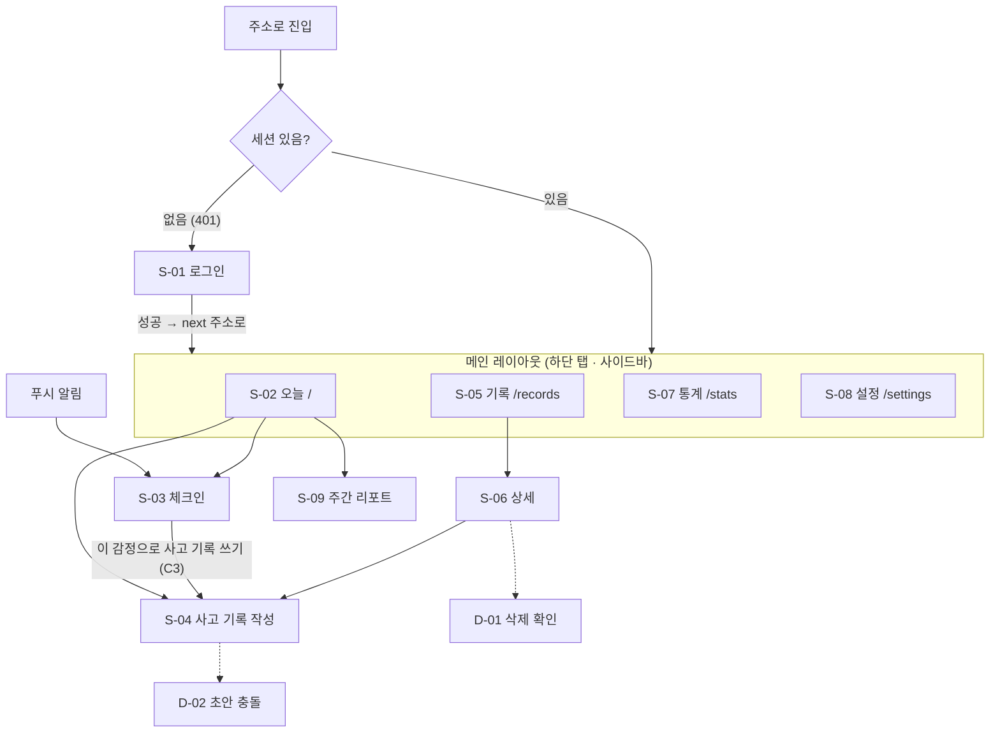

# 화면 설계

> **화면이 어떻게 생겼고, 왜 그렇게 동작하는지** 적는 문서다. 화면 규격 · 색 결정의 단일 출처다.
> 기능 번호(C1 · T3 등)는 [REQUIREMENTS.md](REQUIREMENTS.md), 저장 방식은 [DATA_MODEL.md](DATA_MODEL.md), 인증 흐름은 [ARCHITECTURE.md](ARCHITECTURE.md) 4절.
> 그림(목업)은 [`mockups/`](mockups/) — 이 문서의 결정을 보여 주는 참고 자료다.

## 1. 이 앱의 화면 원칙
일반 앱 원칙(접근성, 로딩 처리 등)은 7 ~ 8장에. 여기는 **감정 기록 앱이라서** 지키는 것만.

1. **마찰을 줄인다.** 체크인은 앱을 열고 10초 안에 끝나야 한다(C1). 자주 누르는 버튼은 엄지가 닿는 화면 아래쪽에, 터치 영역은 44px 이상.
2. **감정을 평가하지 않는다.**
   - 감정에 "좋은 색 / 나쁜 색"을 붙이지 않는다. 빨강 · 초록으로 강도나 변화를 표시하지 않는다(6장).
   - 강도가 안 줄었거나 늘어도 실패처럼 보이게 하지 않는다. "−45" 같은 숫자는 보여 주되 빨간 화살표 · 경고 아이콘은 없다.
   - 점수 · 등급 · 연속 기록 압박("기록이 끊겼어요!") 문구를 쓰지 않는다.
3. **화면 밖으로 내용이 새지 않게 한다.** 푸시 알림 · 탭 제목 · 공유 미리보기에 기록 내용(상황 · 생각 · 메모)을 넣지 않는다.
4. **쓰던 걸 잃지 않게 한다.** 사고 기록은 길다. 자동 임시저장(T3)이 지금 저장됐는지 늘 보이고, 저장이 실패하면 숨기지 않고 알린다.

## 2. 화면 목록

| ID | 화면 | 주소 | 우선 | 설명 |
|---|---|---|:---:|---|
| S-01 | 로그인 | `/login` | M | 가입은 `ALLOW_SIGNUP`이 켜졌을 때만 전환 링크 표시 |
| S-02 | 오늘 (홈) | `/` | M | 체크인 버튼, 오늘 기록, 이어 쓸 초안 |
| S-03 | 체크인 | `/checkin` | M | 감정 · 강도 · 메모. 푸시 알림을 누르면 바로 여기 |
| S-04 | 사고 기록 작성 · 수정 | `/records/new?draft=…&step=…` · `/records/:id/edit` | M | 한 화면 한 칸 단계형 (T2) |
| S-05 | 기록 목록 | `/records` | M | 체크인 + 사고 기록, 날짜별 |
| S-06 | 사고 기록 상세 | `/records/:id` | M | 7칸 전체, 전 · 후 강도 |
| S-07 | 통계 | `/stats?range=…` | M | 추이 · 전후 변화 · 왜곡 비율 |
| S-08 | 설정 | `/settings` | M | 계정 · 시간대 · 테마 · 리마인더 · 내보내기 · 탈퇴 |
| S-09 | 주간 리포트 | `/reports/:week_start` | S | 한 주 요약 |
| D-01 | 삭제 확인 | 다이얼로그 | M | 기록 · 체크인 삭제 |
| D-02 | 초안 충돌 | 다이얼로그 | M | 다른 기기에서 먼저 저장됨 (DATA_MODEL 4.3절의 409) |

**페이지 / 다이얼로그 기준**: 주소로 다시 들어올 만하거나 입력이 많으면 페이지, 지금 화면 위에서 끝나는 확인 · 선택이면 다이얼로그. 체크인(S-03)은 짧지만 **푸시 알림에서 주소로 바로 들어와야 해서** 페이지다.

## 3. 이동 구조

### 3.1 화면 흐름

실선은 페이지 이동, 점선은 다이얼로그.

- **로그인 뒤 가려던 주소로 돌아간다.** `?next=`는 앱 내부 경로(`/`로 시작하고 `//`로 시작하지 않는 것)만 받는다 — 바깥 주소로 튕기는 오픈 리다이렉트 방지.
- **화면 상태는 주소에.** 목록 필터 · 통계 기간 · 작성 중 단계(`step`)를 쿼리에 둔다. 새로고침 · 뒤로가기에도 보던 화면이 유지된다.
- 앱을 열면 세션 확인이 끝날 때까지 짧은 로딩을 보여 준다(로그인 화면이 번쩍 보였다 사라지지 않게).

### 3.2 레이아웃
```
[모바일 · 48rem 미만]                [데스크톱 · 48rem 이상]
┌──────────────────────┐            ┌────────────┬──────────────────────────┐
│ 화면 제목     [동작]  │            │ 로고        │ 화면 제목          [동작] │
├──────────────────────┤            │ ▸ 오늘      ├──────────────────────────┤
│                      │            │   기록      │                          │
│       본문            │            │   통계      │   본문 (최대 폭 40rem,    │
│                      │            │   설정      │   가운데 정렬)            │
├──────────────────────┤            │             │                          │
│ 오늘  기록  통계  설정 │            │ [+ 체크인]  │                          │
└──────────────────────┘            └────────────┴──────────────────────────┘
```
- 기준은 `48rem`(Tailwind `md:`). px이 아니라 rem이라 브라우저 글꼴을 키운 사람은 더 일찍 모바일 배치를 받는다 — 글자가 크면 한 줄에 들어가는 정보가 적으니 의도에 맞다.
- 모바일 하단 탭은 4개. 체크인은 탭이 아니라 S-02의 큰 버튼 + 데스크톱 사이드바 버튼(가장 자주 하는 동작을 메뉴 사이에 묻지 않는다).
- **사고 기록 작성(S-04) 중에는 하단 탭을 숨긴다.** 실수로 다른 탭을 눌러 흐름이 끊기지 않게, 키보드가 올라왔을 때 화면을 더 쓰게.
- 데스크톱도 본문은 좁게(최대 40rem). 글을 쓰는 앱이라 한 줄이 너무 길면 읽기 · 쓰기가 불편하다.

## 4. 화면별 상세
와이어프레임은 **무엇이 어떤 순서로** 들어가는지만 보여 준다. 모바일 폭 기준.

### 4.1 S-02 오늘 (홈)
```
┌──────────────────────────┐
│ 10월 29일 수요일           │
├──────────────────────────┤
│ ┌──────────────────────┐ │
│ │  지금 기분 어때?       │ │  ← 가장 큰 버튼 → S-03
│ │      [ 체크인 ]        │ │
│ └──────────────────────┘ │
│  [ 사고 기록 쓰기 ]        │  ← 보조 버튼 → S-04
├──────────────────────────┤
│ 이어 쓰기                  │  ← 초안이 있을 때만
│  · 회의 끝나고… 3/8단계  2시간 전 │
├──────────────────────────┤
│ 오늘                      │
│  09:12 불안 60 · 피곤 40   │
│  13:40 짜증 70             │
│  18:05 사고 기록 · 불안 80→35 │
└──────────────────────────┘
```
| 항목 | 규격 |
|---|---|
| 이어 쓰기 | 초안 목록(최근 저장순). 상황 칸 앞부분 + 단계 + 저장 시각. 길게 누르거나 `⋮`로 초안 삭제 |
| 오늘 목록 | "오늘" = 사용자 시간대 기준 하루. 체크인 · 사고 기록을 시간순 |
| 주간 리포트 | 새 리포트가 있으면 맨 위에 한 줄 카드 → S-09 (S) |

### 4.2 S-03 체크인
```
┌──────────────────────────┐
│ ×  체크인          [저장] │
├──────────────────────────┤
│ 지금 어떤 감정이야?         │
│ [불안✓][두려움][슬픔]       │  ← 칩, 여러 개
│ [무기력][분노][짜증✓]       │
│ [수치심][죄책감][외로움][좌절]│
├──────────────────────────┤
│ 불안         ━━━━━●── 60  │  ← 고른 감정마다 강도
│ 짜증         ━━●───── 30  │
├──────────────────────────┤
│ 메모 (선택)                │
│ ┌──────────────────────┐ │
│ └──────────────────────┘ │
│ 시각  지금 ▾               │
└──────────────────────────┘
```
| 항목 | 규격 |
|---|---|
| 강도 입력 | 슬라이더 0 ~ 100, 5 단위. 칩을 고르면 슬라이더가 **50**에서 시작(0에서 시작하면 매번 끌어야 한다). 숫자는 슬라이더 옆에 항상 표시 |
| 저장 버튼 | 감정 1개 이상이면 활성. 모바일은 화면 아래 고정 버튼으로도 |
| 저장 후 | S-02로 돌아가고 토스트 "기록했어" + **[사고 기록 쓰기]** 버튼(C3, 5초). 강도 70 이상이면 토스트 대신 S-02 맨 위 안내 카드로 조금 더 오래 보여 준다 |
| 메모 | 한 줄(최대 200자). 상세한 건 사고 기록으로 |

> 강도 70 기준은 처음 정한 값이다. 써 보고 조정한다.

### 4.3 S-04 사고 기록 작성 (단계형)
```
┌──────────────────────────┐
│ ←  사고 기록    저장됨 · 방금 │  ← 저장 상태 늘 표시
│ ■■■□□□□□  3 / 8           │
├──────────────────────────┤
│ 그때 머릿속에 스친 생각은?    │  ← 단계 제목 (질문형)
│ 떠오른 그대로 써도 돼.       │  ← 도움말 한 줄
│ ┌──────────────────────┐ │
│ │                      │ │
│ │                      │ │
│ └──────────────────────┘ │
├──────────────────────────┤
│ [ 이전 ]        [ 다음 ]  │  ← 화면 아래 고정
└──────────────────────────┘
```
| 단계 | 내용 | 필수 |
|---|---|:---:|
| 1 | 상황 + 일어난 시각(T6) | ✓ |
| 2 | 감정 고르기 + 각각 강도(전) — S-03과 같은 부품 | ✓ (1개 이상) |
| 3 | 자동 사고 | ✓ |
| 4 | 인지 왜곡 고르기(복수). 항목을 펼치면 설명 · 예시(T4, 사용자가 쓴 문구. 비어 있으면 이름만) | |
| 5 | 근거 — 자동 사고가 맞다고 볼 수 있는 사실 | |
| 6 | 반대 근거 — 자동 사고와 맞지 않는 사실 | |
| 7 | 대안 사고 — 5 · 6을 보고 균형 잡힌 생각. **3번 자동 사고를 위에 접어서 보여 준다** | ✓ |
| 8 | 감정 다시 매기기(후) — 2단계 감정마다, 전 강도를 흐리게 같이 표시 | ✓ |
| 완료 | 요약 카드(감정 전 → 후) → [완료] → S-06 | |

| 항목 | 규격 |
|---|---|
| 자동 저장 | 입력이 1.5초 멈추면 저장(T3). 헤더에 `저장 중…` / `저장됨 · 방금` / `저장 안 됨 · 다시 시도` |
| 저장 실패 | 헤더 문구 + 작은 재시도 버튼. 내용은 화면에 그대로 남는다. 이 상태에서 나가려 하면 확인을 묻는다 |
| 첫 진입 | 1단계에서 처음 입력할 때 초안을 만든다(빈 초안을 만들지 않는다) |
| 이동 | 필수 칸이 비면 [다음] 비활성. 단계는 앞뒤로 자유롭게 이동. 주소의 `step`이 바뀐다 |
| 키보드 | 입력칸이 화면 아래 고정 버튼 · 키보드에 가리지 않게 한다 |
| 수정 모드 | `/records/:id/edit` — 초안을 쓰지 않고(DATA_MODEL 4.3절) 마지막에 [저장] 한 번 |
| 충돌 (D-02) | "다른 기기에서 이 초안을 먼저 고쳤어." → [그쪽 내용 불러오기] / [지금 내용으로 덮어쓰기] |

> **단계 제목 · 도움말 문구는 초안이다.** 인지 왜곡 설명처럼 사용자가 다듬는다(REQUIREMENTS T4와 같은 이유).

### 4.4 S-05 기록 목록
```
┌──────────────────────────┐
│ 기록            [필터]    │
├──────────────────────────┤
│ 10월 29일 (수)            │  ← 날짜 머리 (사용자 시간대)
│ ┌──────────────────────┐ │
│ │ 사고 기록 · 18:05      │ │
│ │ 불안 80 → 35           │ │
│ │ "또 내가 망쳤다…"       │ │  ← 자동 사고 앞부분 1줄
│ └──────────────────────┘ │
│  13:40 체크인 · 짜증 70    │  ← 체크인은 한 줄로 가볍게
│ 10월 28일 (화)            │
│   ⋮                       │
└──────────────────────────┘
```
| 항목 | 규격 |
|---|---|
| 정렬 · 로딩 | 일어난 시각 최신순, 날짜 묶음 단위로 더 불러오기 |
| 사고 기록 카드 | 감정이 여러 개면 변화가 가장 큰 감정 하나 + "외 2" |
| 체크인 줄 | 누르면 펼쳐서 메모 · 수정 · 삭제 (별도 상세 화면 없음) |
| 필터 (V3, S) | 기간 · 감정 · 왜곡 · 검색어. 주소 쿼리에 반영 |

### 4.5 S-06 사고 기록 상세
- 7칸을 작성 순서대로. 감정은 표로: `불안  80 → 35`, `수치심  60 → 50`.
- 상단 `[수정]` · `⋮`(삭제 → D-01).
- 변화 숫자는 무채색 + 숫자만. 줄었다고 초록, 늘었다고 빨강을 쓰지 않는다(1장 원칙 2).

### 4.6 S-07 통계
| 블록 | 내용 | 차트 |
|---|---|---|
| 기간 | 7일 / 30일 / 90일 탭, 주소 `?range=` | |
| 요약 타일 | 체크인 수 · 사고 기록 수 · 평균 강도 변화(D2) · 연속 기록 일수(D4, S) | |
| 감정 추이 (D1) | 날짜별 평균 강도. 감정 필터 칩 | 선 |
| 전 · 후 변화 (D2) | 사고 기록마다 전 · 후 두 점을 잇는 선 | 점 + 선 |
| 인지 왜곡 (D3) | 많이 고른 순 | 가로 막대 (도넛은 항목 11개에선 읽기 어렵다) |

- 계산은 전부 서버. 화면은 받은 값을 그리기만 한다.
- 연속 기록 일수는 숫자만 조용히. 끊겨도 아무 말 하지 않는다.

### 4.7 S-08 설정
| 묶음 | 항목 |
|---|---|
| 계정 | 닉네임, 이메일(읽기 전용), 비밀번호 변경 |
| 표시 | 시간대(기본 Asia/Seoul), 테마 `시스템 / 라이트 / 다크` |
| 리마인더 (S) | 알림 허용 버튼(브라우저 권한 요청은 **이 버튼을 눌렀을 때만**), 시각 목록 + 요일, 테스트 알림 보내기 |
| 데이터 (S) | 내보내기(JSON 다운로드), 회원 탈퇴(비밀번호 재입력 + 확인 문구 입력) |
| | 로그아웃 |

- 휴대폰에서 웹 푸시는 홈 화면에 설치(R3)해야 동작하는 환경이 있다. 설치 전이면 리마인더 묶음에 설치 방법 안내를 보여 준다.

### 4.8 S-01 로그인
- 이메일 · 비밀번호 · [로그인]. 실패 문구는 하나로 통일: "이메일 또는 비밀번호가 맞지 않아." (어떤 이메일이 가입됐는지 알려주지 않게)
- 요청 제한(429)이면 "잠시 뒤에 다시 시도해 줘" + 남은 시간.

## 5. 부품

### 5.1 shadcn-svelte에서 가져올 것
Button · Card · Input · Textarea · Label · Slider · Toggle Group(감정 칩) · Checkbox · Tabs · Dialog · Alert Dialog · Sheet · Dropdown Menu · Sonner(토스트) · Skeleton · Chart · Form 부품.
생성된 원본(`src/lib/components/ui/`)은 고치지 않고 감싸서 쓴다(ARCHITECTURE 2절).

### 5.2 직접 만들 것
| 부품 | 쓰는 곳 |
|---|---|
| `EmotionPicker` (칩 + 고른 감정별 강도 슬라이더) | S-03, S-04 2 · 8단계 |
| `IntensityChange` (전 → 후 숫자, 무채색) | S-02, S-05, S-06 |
| `StepShell` (진행 막대 · 저장 상태 · 하단 이전/다음) | S-04 |
| `SaveStatus` (저장 중 / 됨 / 실패 + 재시도) | S-04 |
| `RecordCard` · `CheckinRow` | S-02, S-05 |
| `DayHeader` (사용자 시간대 날짜) | S-02, S-05 |

## 6. 색 · 서체 · 테마

> **색은 아직 정하지 않았다.** 컬러 시안 목업(9장)을 보고 고른 뒤 이 절에 토큰 표를 채운다. 아래는 시안이 지켜야 할 조건이다.

**색 원칙**
- 포인트 색 **하나** + 무채색. 포인트 색은 주 버튼 · 활성 메뉴 · 선택 상태에만.
- 차분한 계열에서 고른다(채도 낮은 청록 · 남색 · 세이지 등). **빨강 · 주황 · 초록은 포인트 색 후보에서 뺀다** — 각각 경고 · 좋음/나쁨 신호로 읽힌다.
- **강도는 포인트 색 하나의 명도 단계**로 표시한다(0은 옅게, 100은 진하게). 감정 종류마다 다른 색을 주지 않는다 — 색이 감정의 "좋고 나쁨"을 말하게 된다.
- 폼 오류색은 포인트 색 · 강도 색과 따로 둔다. 오류는 색만이 아니라 아이콘 + 문구로.
- 글자 대비 4.5:1 이상, 큰 글자 · 아이콘 3:1 이상. 다크 · 라이트 둘 다 확인.

**서체** · Pretendard 하나 (숫자도 Pretendard의 고정폭 숫자 `tabular-nums`로 — 강도 숫자가 바뀔 때 흔들리지 않게).

**테마** · 라이트 · 다크 둘 다. 기본은 시스템 설정을 따르고 S-08에서 바꾼다. 구현은 shadcn-svelte CSS 변수(`--primary` 등)를 확정한 토큰으로 바꾸고, 다크는 `.dark`로 한 벌 더.

**모양** · 그림자 최소, 모서리 버튼 · 입력 8px / 카드 12px / 칩 원형. 터치 영역 44px 이상.

## 7. 빈 상태 · 로딩 · 오류

| 상황 | 처리 |
|---|---|
| 첫 사용 (S-02) | "첫 체크인을 해 볼까?" + 체크인 버튼 |
| 기록 없음 (S-05) | "아직 기록이 없어" + 체크인 버튼 |
| 필터 결과 없음 | "조건에 맞는 기록이 없어" (버튼 없음 — 필터를 바꾸면 되니까) |
| 통계 데이터 부족 | 기간 안 기록 3개 미만이면 차트 대신 "기록이 조금 더 쌓이면 보여 줄게" |
| 처음 로딩 | 자리에 skeleton. **이미 있는 내용을 로딩 중이라고 지우지 않는다** |
| 저장 중 | 버튼 비활성 + 표시. 중복 제출 막기 |
| 네트워크 오류 | "연결이 안 돼" + [다시 시도] |
| 401 | 클라이언트 한 곳에서 처리 → S-01 (`next` 기억). 화면마다 따로 처리하지 않는다 |
| 404 | "찾을 수 없는 기록이야" + 목록으로 (남의 기록도 같은 화면) |

## 8. 문구 · 접근성

**문구 톤**
- 반말, 짧게, 친구가 옆에서 말하듯. 훈계 · 진단 · 과한 칭찬 없이 ("잘했어요!", "부정적인 생각이에요" X).
- 버튼은 동사로 (`저장`, `체크인`, `다시 시도`).
- 시각은 사용자 시간대로, 오늘 · 어제는 말로("어제 18:05").

**접근성**
- 키보드만으로 전부 쓸 수 있다. 슬라이더는 화살표(5) · PageUp/Down(10)으로 조절된다.
- 칩 · 슬라이더에 보이는 이름과 같은 라벨(`aria-label="불안 강도"`).
- 초점 링을 지우지 않는다. 지우면 감싼 요소에 `focus-within` 링.
- OS의 "동작 줄이기"가 켜져 있으면 전환 애니메이션을 끈다.

## 9. 목업
- 위치: `docs/mockups/`. **로컬 HTML 파일로만 만든다.** claude.ai 캔버스 · Artifact에 올리지 않는다(CLAUDE.md 업로드 금지 규칙).
- 브라우저로 그냥 열면 보이는 단일 HTML(필요하면 같은 폴더의 공용 스크립트 하나). 파일 하나 = 보드 하나.
- **지금 그리는 것**: 9.1절. 나머지 화면은 그 화면을 구현하는 단계에서 필요할 때만.

### 9.1 목업 계획
| 보드 | 언제 | 왜 |
|---|---|---|
| 컬러 시안 3 ~ 4개 · 라이트/다크 · 강도 명도 단계 | 지금 (구현 전) | 6장 토큰을 정해야 뼈대 단계에서 테마를 깐다 |
| S-03 체크인 · 모바일 | 지금 | 10초 목표(C1)가 이 배치로 되는지 눈으로 확인 |
| S-04 사고 기록 단계 화면 · 모바일 (3단계 · 8단계 · 저장 실패) | 지금 | 앱의 핵심이고 가장 복잡한 화면 |
| S-02 · S-05 · S-06 · S-07 · S-08 | 각 화면 구현 단계 | 위 셋이 정해지면 나머지는 같은 부품의 조합이라, 미리 그리면 구현 때 다시 고치게 된다 |

---

## 변경 이력
| 날짜 | 내용 |
|---|---|
| 2026-10-29 | v2 첫 작성. 색 토큰은 컬러 시안 뒤 확정 (6장) |
